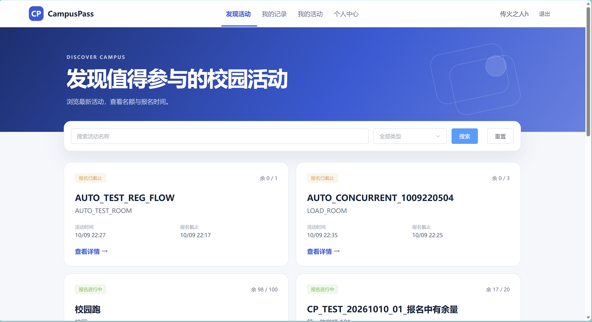
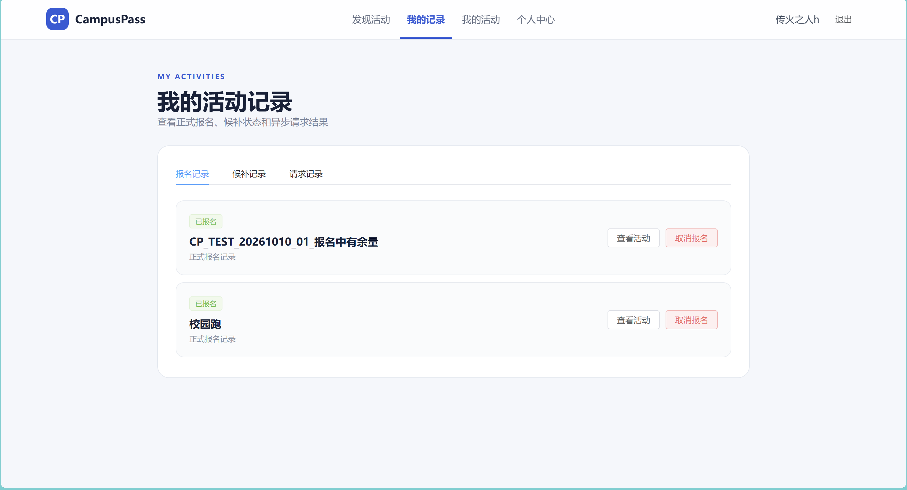
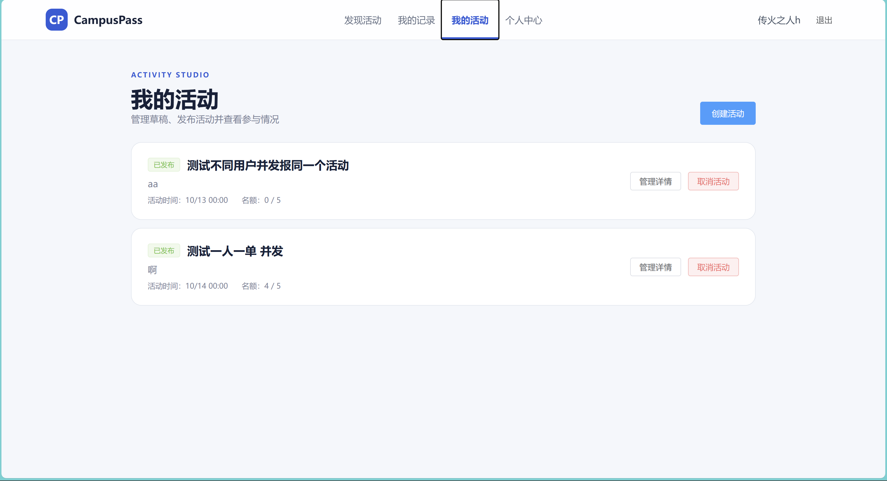
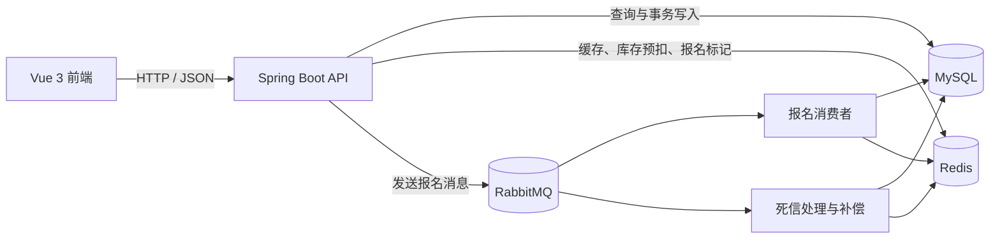

# CampusPass 校园活动报名系统

CampusPass 是一个面向校园活动场景的前后端分离报名系统，覆盖活动发布、活动检索、限额报名、候补排队、取消与自动递补、用户管理和异常补偿等流程。

项目重点解决热门活动报名中的库存一致性、重复报名、异步处理失败和候补公平性问题。报名请求先通过 Redis Lua 脚本完成原子校验与库存预扣，再交由 RabbitMQ 异步写入 MySQL；消费失败时通过重试、死信处理和定时补偿恢复数据。

## 界面展示

### 发现活动



### 报名与候补记录



### 活动发布与管理



## 主要功能

### 用户功能

- 手机验证码注册与登录、密码登录、退出和找回密码；
- 查看、修改个人资料和修改密码；
- 按关键字、活动类型或组合条件分页查询活动；
- 查看活动详情、报名活动、取消报名和取消候补；
- 查看自己的报名、候补和异步请求处理结果；
- 创建、编辑、发布和取消自己发起的活动；
- 查看自己活动的报名用户与候补用户。

### 管理员功能

- 分页查询用户和活动；
- 禁用、恢复用户；
- 强制取消违规活动；
- 查看活动参与者与候补名单。

### 并发与可靠性设计

- Redis Lua 原子校验报名状态并预扣活动库存；
- RabbitMQ 异步处理报名请求，削减数据库瞬时写入压力；
- Redis 与 Redisson 分布式锁保护关键业务状态；
- 数据库唯一约束与业务校验共同防止重复有效报名；
- 候补队列按照加入时间顺序递补；
- 消息消费重试、死信队列和定时补偿处理异常请求；
- 热点活动缓存及定时缓存初始化、重建机制；
- JWT 登录状态、用户状态和权限版本校验；
- 统一异常处理和分层业务错误码。

## 系统结构



一次报名请求的主要流程：

1. 后端校验登录用户、活动状态和报名时间；
2. Redis Lua 脚本原子判断重复报名、预扣库存并写入参与标记；
3. 后端生成请求编号并向 RabbitMQ 发送消息；
4. 消费者在事务中写入报名或候补记录；
5. 前端通过请求记录和报名状态查看最终处理结果；
6. 失败消息进入重试或死信补偿流程，恢复库存和参与标记。

## 技术栈

| 模块 | 技术 |
| --- | --- |
| 后端 | Java 17、Spring Boot 4.1.1、Spring MVC、Spring Validation |
| 数据访问 | MyBatis-Plus 3.5.16、MySQL |
| 缓存与锁 | Redis、Spring Data Redis、Redisson 4.7.0、Lua |
| 消息队列 | RabbitMQ、Spring AMQP |
| 身份认证 | JWT（JJWT 0.12.6） |
| 接口文档 | Springdoc OpenAPI、Swagger UI、Apifox |
| 前端 | Vue 3、TypeScript、Vite、Vue Router、Pinia、Element Plus、Axios |
| 测试 | JUnit 5、Apifox、JMeter 5.6.3 |

## 项目结构

```text
campus-pass/
├─ src/main/java/       后端业务代码
├─ src/main/resources/  配置、Mapper XML 和 Lua 脚本
├─ src/test/            后端自动化测试
├─ frontend/            Vue 前端项目
├─ sql/                 建表脚本和本地测试数据
├─ tests/apifox/        已脱敏的接口测试集合
├─ tests/jmeter/        并发测试脚本与示例数据
└─ docs/                错误码和测试文档
```

## 本地运行

### 1. 环境要求

- JDK 17；
- Node.js 22.18 及以上，或 24.12 及以上；
- MySQL；
- Redis；
- RabbitMQ。

### 2. 初始化数据库

先在 MySQL 中创建并选择数据库：

```sql
CREATE DATABASE IF NOT EXISTS campus_pass
    DEFAULT CHARACTER SET utf8mb4;

USE campus_pass;
```

随后执行：

```text
sql/CampusPass.sql
```

需要分页和并发测试数据时，再阅读文件开头的准备条件并执行：

```text
sql/CampusPass-test-data.sql
```

测试数据脚本仅适用于本地开发和测试环境。

### 3. 配置后端环境变量

| 环境变量 | 说明 | 示例 |
| --- | --- | --- |
| `MYSQL_URL` | MySQL JDBC 地址 | `jdbc:mysql://localhost:3306/campus_pass?useSSL=false&serverTimezone=Asia/Shanghai&characterEncoding=utf8` |
| `MYSQL_USERNAME` | MySQL 用户名 | `root` |
| `MYSQL_PASSWORD` | MySQL 密码 | 本机实际密码 |
| `REDIS_HOST` | Redis 地址 | `localhost` |
| `REDIS_PORT` | Redis 端口，可省略 | `6379` |
| `RABBITMQ_HOST` | RabbitMQ 地址 | `localhost` |
| `RABBITMQ_PORT` | RabbitMQ 端口，可省略 | `5672` |
| `RABBITMQ_USERNAME` | RabbitMQ 用户名 | 本机实际用户名 |
| `RABBITMQ_PASSWORD` | RabbitMQ 密码 | 本机实际密码 |
| `RABBITMQ_VIRTUAL_HOST` | RabbitMQ Virtual Host | `/` |
| `CAMPUS_PASS_JWT_SECRET` | Base64 编码的 JWT 密钥 | 使用随机值 |

可以使用 PowerShell 生成 JWT 密钥：

```powershell
$bytes = New-Object byte[] 32
[Security.Cryptography.RandomNumberGenerator]::Fill($bytes)
[Convert]::ToBase64String($bytes)
```

在 IDEA 中可通过“运行 → 编辑配置 → 环境变量”设置以上变量。请勿把真实密码或 JWT 密钥提交到 Git。

### 4. 启动后端

Windows：

```powershell
.\mvnw.cmd spring-boot:run
```

macOS 或 Linux：

```bash
./mvnw spring-boot:run
```

后端默认地址为 `http://localhost:8080`，Swagger UI 位于：

```text
http://localhost:8080/swagger-ui/index.html
```

### 5. 启动前端

```bash
cd frontend
npm install
npm run dev
```

浏览器访问 `http://localhost:5173`。开发服务器会把 `/api` 请求代理到 `http://localhost:8080`。

### 6. 创建管理员

先通过注册接口创建普通用户，再在本地数据库中把指定用户设为管理员：

```sql
UPDATE tb_user
SET role = 1
WHERE phone = '替换为已注册手机号';
```

修改后重新登录，使新的角色信息生效。项目不会在正式建表脚本中写入固定管理员密码。

## 测试

运行后端自动化测试：

```powershell
.\mvnw.cmd clean test
```

检查并构建前端：

```bash
cd frontend
npm run build
```

其他测试材料：

- [测试说明](docs/testing.md)
- [并发测试报告](docs/concurrency-test-report.md)
- [Apifox 导入与使用说明](tests/apifox/README.md)
- [业务错误码](docs/error-codes.md)


## 当前验证结果

- 后端自动化测试：10 个用例全部通过；
- 前端 TypeScript 检查与生产构建通过；
- 同一用户 20 次并发报名仅产生一条有效关系；
- 20 个不同用户竞争 5 个名额，最终 5 人报名、15 人候补、剩余名额为 0；
- 未发现超卖、重复有效报名或同一用户同时处于报名和候补状态。

并发数据来自本地功能与一致性验证，用于证明并发控制正确，不代表生产环境容量上限。详细数据见[并发测试报告](docs/concurrency-test-report.md)。

